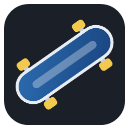

<p align="center">
  
</p>

# THPS 2X Recompiled - Android

The Android version of [THPS 2X Recompiled](https://github.com/almost-drowned-rat/THPS2X-Recompiled), the static
recompilation of *Tony Hawk's Pro Skater 2X* (Xbox, USA). One app: you pick your own disc image, the game is
translated and compiled **on your device** once, and then it plays - with a gamepad, a handheld's own controls or
touch controls.

> This project contains **no game data, no game code and no keys**. You need your own copy of the game (USA disc
> image). The app never contains any of the game's code: it is built on your device from your own disc.

> **AI disclosure:**  AI assistance yes (Claude Code by Anthropic).

> **I am sorry** for everyone whose device has no **Vulkan 1.3** and cannot use a **Turnip** driver either: the game
> needs one of the two, and on those devices it will not run. There is nothing I can do about that from the app's side.

> **A Turnip driver is recommended.** On Snapdragon devices use the app with a **Turnip** driver (Mesa's open Vulkan
> driver for Adreno GPUs). Tested with **purple-turnip T30** -
> [`turnip_mrpurple_T30-toasted.adpkg.zip`](https://github.com/MrPurple666/purple-turnip/releases/tag/vturnip_mrpurple_T30-toasted.adpkg)
> (Mesa Turnip 26.3.0, by MrPurple666). Download that file to your device and choose it in the app (see *How it
> works*). The driver is not part of the app.

> **Only tested on Snapdragon.** I can only test on a **Snapdragon 8 Gen 2** (Adreno 740), so I cannot test any other
> chip (Exynos, Tensor, MediaTek / Mali, older Snapdragons).

---

## Status

**v2.0.0** - the same version as the Windows / Linux port it is built from
([THPS2X-Recompiled v2.0.0](https://github.com/almost-drowned-rat/THPS2X-Recompiled/releases/tag/v2.0.0)). Download
the APK from [Releases](https://github.com/almost-drowned-rat/THPS2X-Recompiled-Android/releases) and install it
(Android 10+, arm64). It is signed with the project's own key - every later update installs over it.

Updates install over the previous version and keep your saves. To get them automatically, add this repository to
[Obtainium](https://github.com/ImranR98/Obtainium) (`https://github.com/almost-drowned-rat/THPS2X-Recompiled-Android`).

Tested on:

| Device | Chip / GPU | Driver | Result |
|---|---|---|---|
| AYN Odin 2 Portal | Snapdragon 8 Gen 2 / Adreno 740 | purple-turnip T30 | menus and levels at 60 fps, 120 fps with FRAME RATE 120, built-in controls work |

## Features

- **The whole game, native on your device** - no emulator: the Xbox program is translated to C and compiled for
  arm64 on the device; the picture is drawn with **Vulkan**.
- **Built from your own disc** - the app carries no game code; the first start builds the game once (a few minutes),
  then every start goes straight into the game.
- **One setup screen** (the standard of all my Android ports): your disc image and the graphics driver, a progress
  bar with the step and its time, **Quit** asks first and stops cleanly.
- **Graphics driver of your choice** - the system driver or a **Turnip** package (`.adpkg.zip`) from a file; up to 5
  packages are kept and can be switched in the BACK menu. No driver comes with the app.
- **Everything of the [PC port v2.0.0](https://github.com/almost-drowned-rat/THPS2X-Recompiled#readme)** - the classic
  career, THPS 1 score calculation, the original THPS 2 physics, button cheats, custom soundtracks, RECOMP OPTIONS
  (DISPLAY, POST PROCESSING, PERFORMANCE, RENDERING, BUTTON CHEATS, BOOT ANIMATION; on Android the game always runs
  full screen).
- **60 or 120 fps** - FRAME RATE 120 in RECOMP OPTIONS runs on the device too (the game never speeds up), on a
  display with 120 Hz.
- **Touch controls**, gamepads and a handheld's own controls.
- **BACK menu** - controls, saves export / import, log export, boot animation, graphics driver, licences.

## Requirements

- Android 10 or newer, **arm64** (64-bit ARM)
- A system driver with **Vulkan 1.3**, or on an **Adreno GPU** a **Turnip driver package** (`.adpkg.zip`;
  recommended, link above). No driver is shipped with the app.
- Your own **Tony Hawk's Pro Skater 2X (USA)** disc image (`.iso`)
- Free storage: about **3 GB** during the first start (the image is copied in and extracted), about **1.5 GB** after it

## How it works

1. Install the app and start it. The setup screen opens.
2. **Browse...** your disc image.
3. **Graphics driver (change...)**: keep the *system driver*, or choose *Turnip driver from a file* and pick the
   Turnip package (`turnip_mrpurple_T30-toasted.adpkg.zip`, e.g. from your Download folder). You can change it any
   time later in **BACK > Settings > Graphics driver**.
4. **Install.** The image is copied into the app and extracted (the copy is deleted afterwards; your own file stays
   where it is), then the game's code is translated and compiled on the device - **once**, a few minutes (and once
   more after an app update, without asking for the disc again). Keep the app open; the screen stays on. **Quit**
   asks first, then stops cleanly.
5. **Play.** Every later start goes straight into the game.

**Frame rate at first:** in the first minutes the frame rate can drop now and then: every new effect, scene or menu
needs its shaders built once on the device, and they are kept for the next time.

**Your files - saves and media:** they live in the app's folder in shared storage, reachable with adb or a file
manager (one that shows `Android/data`):

```
/storage/emulated/0/Android/data/io.github.almostdrownedrat.thps2x/files/
  saves/   your career, skaters, parks + settings.ini
  media/   boot.mpg (your own boot animation) and your own soundtracks (one folder per album)
```

Back up your saves with `adb pull /sdcard/Android/data/io.github.almostdrownedrat.thps2x/files/saves`.
**Uninstalling the app deletes this folder too** - back up first. The game itself (translated and compiled from your
disc) stays in the app's internal storage.

**Custom soundtracks:** copy folders of MP3 / FLAC / Ogg Vorbis / WAV files into `media/` (each folder with music is
one album, as on the PC) and choose them in OPTIONS > GENERAL OPTIONS > SOUNDTRACKS.

**Boot animation (optional):** your own `boot.mpg` (MPEG-1 video + MP2 audio, like the PC port) plays before the
game. Either **BACK > Settings > Boot animation > Import file...**, or copy it into `media/` with adb. Turn it on /
off in the game: OPTIONS > RECOMP OPTIONS > BOOT ANIMATION.

## Controls

- **Gamepads** work out of the box. With the touch buttons on *Automatic* they hide while a gamepad is used.
- **Touch:** a floating stick on the left, A B X Y, WHITE / BLACK, LT / RT and START. BACK, L3 / R3, the D-pad and a
  right stick exist too, hidden by default.
- **BACK** opens a menu that slides in from the left, in the same order as in all my Android ports:
  - **Back to the game**
  - **Controls** - touch buttons on / off / automatic, the connected controllers, move and resize the touch buttons,
    button size, hide single buttons, opacity, stick sensitivity, reset the layout
  - **Settings**
    - **Saves** - export your saves as one zip, or import such a zip (your current saves are kept as a backup)
    - **Export log** - the log of one of the last 5 starts, or of all of them, to a file you choose - please attach
      it to a bug report
    - **Boot animation** - none, or import your boot.mpg
    - **Graphics driver** - the driver in use, up to 5 kept Turnip packages (add / remove), the system driver
    - **About and licences**

## Troubleshooting

| What you see | Why | What to do |
|---|---|---|
| "App not installed" when installing | Android older than 10, or a 32-bit / x86 device | the app needs Android 10+ on arm64 - it cannot run on this device |
| "Graphics driver needed" at the first start | an Adreno GPU whose own driver offers less than Vulkan 1.3 | choose a Turnip package (link above) |
| A message on the setup screen, then the app closes | a step of the build failed | **BACK > Settings > Export log** after the next start; please open an issue |
| "I am sorry - ... offers only Vulkan ..." at the first start | no Adreno GPU and less than Vulkan 1.3 | Turnip exists only for Adreno - the game cannot run on this device |
| "Not enough storage" after choosing the image | the first start needs about twice the image's size free | free some storage and choose the image again |
| The progress bar runs for minutes | the game is translated and compiled on the device (first start, after an update) | wait |
| Graphics glitches | the phone's own driver | use Turnip T30 (BACK > Settings > Graphics driver) |

## Building

The APK is built on Linux with `packaging/android/build_android.sh` (Android SDK 36, NDK r30, JDK 21, Gradle 9.9.1;
the script lists every path it reads as environment variables). The Android project itself is the toolkit's template
(`templates/android`): it needs the toolkit
[xboxrecomp-option-c at tag **thps2x-v2.0.0-android**](https://github.com/almost-drowned-rat/xboxrecomp-option-c/tree/thps2x-v2.0.0-android)
(the exact toolkit source is inside the app), its Android runtime SDK and the on-device compiler, made by the
toolkit's `tools/android` scripts. The release APK is signed with the project's own release key;
`build_android.sh --release` expects it outside the repository.

## Licence

GPL-3.0-or-later (see `LICENSE`). Third-party parts the app uses: SDL3 (zlib), CPython (PSF), capstone (BSD-3),
libadrenotools (BSD-2), LLVM / clang / lld (Apache-2.0 with LLVM exception), glslang, the xboxrecomp toolkit (MIT;
the app uses none of its LGPL-2.1 parts from xemu); the full list is in the app (BACK > Settings > About and licences). A Turnip driver
(Mesa, MIT) is never shipped - you choose it.

*Tony Hawk's Pro Skater* is a trademark of Activision. This project is not affiliated with or endorsed by
Activision, Neversoft, Treyarch or Microsoft.
